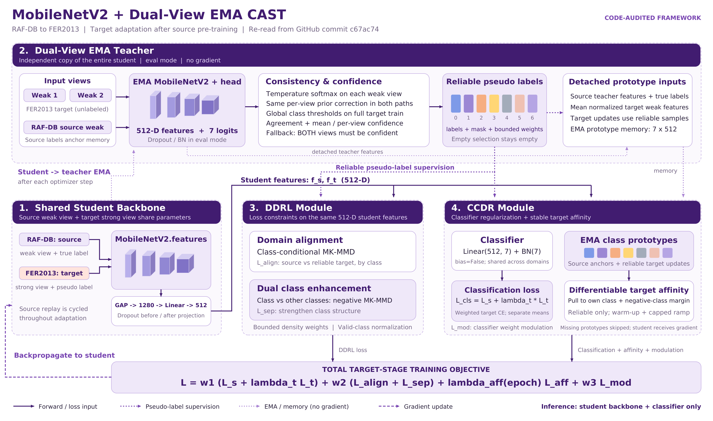

# CAST

This is a PyTorch implementation of the paper:

"Unsupervised Cross-Domain Facial Expression Recognition via Class Adaptive self-Training"
## Original paper environment
Ubuntu 16.04 LTS, Python 3.8, PyTorch 1.8.1
## Datasets
[RAFDB](http://www.whdeng.cn/raf/model1.html),
[AFE](https://github.com/HCPLab-SYSU/CD-FER-Benchmark),
[EXPW](http://mmlab.ie.cuhk.edu.hk/projects/socialrelation/index.html),
[SFEW](https://paperswithcode.com/dataset/sfew),
[FER2013](https://paperswithcode.com/dataset/fer2013)


## IR-50 · RAF-DB → FER2013

This experiment defaults to `ir50`. Training and offline auditing use the same
112×112 RGB crops and normalize to [-1, 1]. IR-50 produces 512-dimensional
features for the CAST classifier, source prototypes and KNN.

Run from the repository root with CUDA-enabled PyTorch and a matching
TorchVision installation. Checkpoint loading for IR-50 and the offline audit
uses the `weights_only` option in `torch.load`.

```bash
CUDA_VISIBLE_DEVICES=0 bash scripts/run_prototype_radius.sh /path/to/raf-basic /path/to/fer2013
```

The launcher runs 30 source epochs and 30 target epochs. IR-50 starts from
random weights unless you provide a local
[face.evoLVe IR_50](https://github.com/ZhaoJ9014/face.evoLVe/blob/master/backbone/model_irse.py)
112×112 backbone state dict:

```bash
CUDA_VISIBLE_DEVICES=0 bash scripts/run_prototype_radius.sh /path/to/raf-basic /path/to/fer2013 \
  --ir50_weights /path/to/ir50_112.pth
```

For target-stage training with an existing CAST IR-50 source checkpoint, pass
`--pre_epochs 0 --checkpoint /path/to/ir50_source_best.pth`. The `--checkpoint`
flag expects a full CAST model, including its expression classifier. Use
`--train_batch_size` (per domain) and `--eval_batch_size` to adjust the default
of 32 for each. The trainer writes logs under `logs/` and checkpoints under
`models/rafdb_fer/`.

The offline auditor reads the backbone from the training checkpoint. To run a
snapshot audit with a recomputed threshold:

```bash
CUDA_VISIBLE_DEVICES=0 python evaluate_pseudo_labels.py \
  --checkpoint models/rafdb_fer/ir50_rafdb_fer_globaltau_fusedknn_l2_classproto_emotionr_q85q85_trainaudit_target_best.pth \
  --source_path /path/to/raf-basic --target_path /path/to/fer2013 \
  --output_dir audit_ir50 --batch_size 32 --recompute_threshold
```

## MobileNetV2 dual-view EMA branch

See [implementation changes and training commands](IMPROVEMENTS.md) and the behavioral tests in `tests/test_cast.py`.

[Code-audited architecture and figure downloads](docs/ARCHITECTURE.md)


