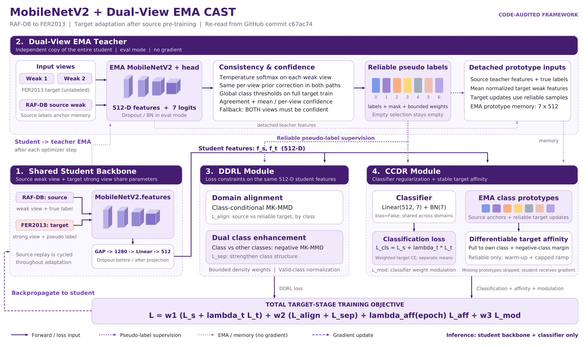

# CAST

This is a PyTorch implementation of the paper:

"Unsupervised Cross-Domain Facial Expression Recognition via Class Adaptive self-Training"
## Current experiment: class-balanced mean/std common radius (v30)

See [formula, parameters, and validation](BALANCED_MEAN_STD_RADIUS_V30.md).
The shared source radius is now `R = mean + k * population_std`, with equal
weight per nonempty class. Set `--source_radius_std_scale 1.0` (default).
Replace the previous `--source_radius_quantile 0.90` option in v29 commands.
The global confidence threshold, KNN rescue, competition checks and stable
anchor promotion retain their v29 behavior.

## Environment
Ubuntu 16.04 LTS, python 3.8, pytorch 1.8.1
## Datasets
[RAFDB](http://www.whdeng.cn/raf/model1.html),
[AFE](https://github.com/HCPLab-SYSU/CD-FER-Benchmark),
[EXPW](http://mmlab.ie.cuhk.edu.hk/projects/socialrelation/index.html),
[SFEW](https://paperswithcode.com/dataset/sfew),
[FER2013](https://paperswithcode.com/dataset/fer2013)

## MobileNetV2 dual-view EMA branch

See [implementation changes and training commands](IMPROVEMENTS.md) and the behavioral tests in `tests/test_cast.py`.

[Code-audited architecture and figure downloads](docs/ARCHITECTURE.md)

